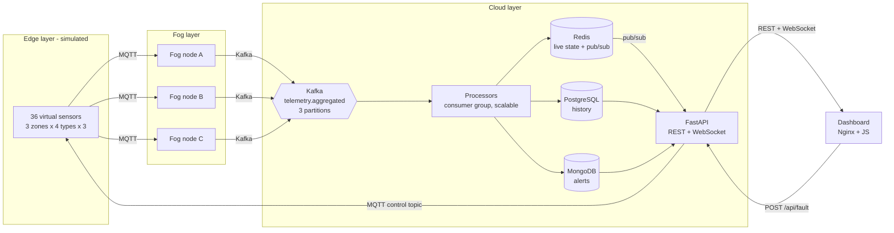

# CityPulse - Real-Time Smart City Monitoring Platform

A distributed Edge -> Fog -> Cloud system that monitors a city in real time.
Simulated IoT sensors in three city zones stream temperature, air quality, traffic
and power-load data. Fog nodes aggregate and classify the data locally, Kafka carries it
to a scalable cloud backend, and a live dashboard shows trends and alerts within seconds.

> The sensors are **simulated in software** (no physical hardware is needed). They publish over MQTT
> exactly as real devices would, so real sensors could be connected without changing any other component.


## Assignment Details

| Field | Answer |
|---|---|
| **Application Name** | CityPulse: Real-Time Smart City Monitoring Platform |
| **Application Description** | Simulated IoT sensors across three city zones stream environmental, traffic and power data. Fog nodes aggregate and classify readings at the zone level, Kafka transports them to cloud processors that store history, track live state and raise alerts, and a web dashboard shows everything in real time. |
| **Architecture Used** | Microservices, event-driven, layered Edge-Fog-Cloud architecture with database-per-purpose storage |
| **Communication Mechanism** | MQTT (sensors to fog), Apache Kafka (fog to cloud), REST API (queries and commands), WebSocket (live push to dashboard), Redis Pub/Sub (processor to API) |
| **Data Storage Type & Technology** | SQL: PostgreSQL (time-series history). NoSQL: MongoDB (alert documents). In-memory: Redis (latest state, live events, counters) |
| **Computing Type** | Distributed computing with Edge, Fog and Cloud layers; horizontally scalable stream processing; containerized |
| **Technology Stack** | Python 3.11, FastAPI, Uvicorn, kafka-python, Eclipse Mosquitto (MQTT), Apache Kafka 3.8 (KRaft), PostgreSQL 16, MongoDB 7, Redis 7, Nginx, HTML/CSS/JavaScript (canvas charts, WebSocket), Docker, Docker Compose |
| **GitHub Repository** | (this repository) |

## Architecture



## How each requirement is used

**Edge (simulator).** 36 virtual sensors publish a reading per second to `citypulse/<zone>/<metric>` over MQTT.
Values follow a compressed day/night wave plus noise. A control topic lets the dashboard inject an emergency.

**Fog (3 nodes, one image).** Each node subscribes only to its own zone. Every 2 seconds it aggregates the
readings (avg/min/max), classifies status (normal/warning/critical) locally, and sends one summary to Kafka.
This reduces upstream traffic by roughly 80 percent (shown live on the dashboard).

**Cloud (processors + API).** Processors form a Kafka consumer group on a 3-partition topic, so adding
replicas shares the load. They write history to PostgreSQL, keep the latest state in Redis, create alerts in
MongoDB when a status changes, and publish live events. The API serves REST queries and pushes events to browsers over WebSocket.

**Why these databases.** PostgreSQL suits time-stamped rows and range queries. MongoDB suits flexible alert
documents. Redis suits instant reads and pub/sub for live updates.

## Run it

Requirements: Docker Desktop (running), about 4 GB free RAM for Docker.

```bash
docker-compose up -d --build
```

First start takes a few minutes (image downloads). Give it about 60 seconds, then open:

- Dashboard: http://localhost:8080
- API docs (Swagger): http://localhost:8001/docs

Check logs: `docker-compose logs -f processor`

## Demo script

1. Open the dashboard and show the live charts and the system health panel.
2. Click **Trigger emergency** (for example Zone B, Air quality). The tile turns amber then red,
   the banner and alert feed update, and the processor logs show `ALERT:`.
3. Wait 25 seconds and watch it recover (a "back to normal" entry appears).
4. Scale the cloud tier: `docker-compose up -d --scale processor=3`. The health panel shows
   three processors, each handling part of the stream.
5. Stop a fog node: `docker-compose stop fog-b`. The dashboard shows it offline and that zone stops updating,
   while other zones continue (fault isolation). Restart with `docker-compose start fog-b`.

## Distributed-systems concepts demonstrated

Edge/fog/cloud tiers, publish-subscribe, event-driven design, message partitioning and consumer groups,
horizontal scaling, polyglot persistence, data reduction at the edge, fault isolation, service discovery by DNS in
Docker networks, containerization.

## Limitations (honest notes)

- Sensors and fog nodes are simulated and run as containers on a single machine. The design maps directly to separate devices and hosts.
- Single-node Kafka (no replication), no authentication on MQTT/API. Suitable for a course demo, not production.
- Deployed with Docker Compose only (not Kubernetes or a public cloud).

## Project structure

```
simulator/   edge: virtual sensors (MQTT publisher)
fog/         fog node: aggregate + classify + forward to Kafka
processor/   cloud: Kafka consumer, writes PostgreSQL/Redis/MongoDB
api/         FastAPI REST + WebSocket
dashboard/   Nginx + single-page dashboard
mosquitto/   MQTT broker config
docker-compose.yml
```

## Academic note

Built for the Distributed Cloud Computing course, NIT Tiruchirappalli. Uses open-source components
(Eclipse Mosquitto, Apache Kafka, PostgreSQL, MongoDB, Redis, FastAPI, Nginx) under their respective licences.

## Version 2 additions

| Feature | How it works |
|---|---|
| **5-page dashboard** | Overview, Analytics, City Map, Alerts & Rules, Operations |
| **Predictive early warning** | `predictor` service fits a 20 s linear trend per sensor and warns about 8-15 s before a limit is crossed (tested: 0 false alarms in 48 h of simulated normal data) |
| **Alert pipeline** | processor and predictor publish alerts to Kafka topic `alerts.events`; `notifier` stores them (MongoDB), pushes them live (Redis -> WebSocket) and sends notifications |
| **User-defined rules** | created in the UI, stored in MongoDB, evaluated by the processors |
| **Notifications** | email and SMS are simulated and logged; Telegram is real if `TELEGRAM_BOT_TOKEN` and `TELEGRAM_CHAT_ID` are set |
| **Analytics** | history from PostgreSQL, zone comparison, heatmap, CSV export |
| **Operations page** | service health, throughput, Kafka topics and consumer lag, processor load |

New Kafka topics: `telemetry.aggregated` (3 partitions), `alerts.events` (1 partition).
New consumer groups: `citypulse-processors`, `citypulse-predictor`, `citypulse-notifier`.

Demo extra: click **Developing incident** on the Overview page and watch the purple early-warning alert arrive before the amber warning.

## Testing

- `python tests/test_predictor.py` : simulates normal operation and gradual incidents and checks the predictor
  (no false alarms; every incident predicted before the real WARNING).
- The full pipeline (MQTT, fog, processors, predictor, notifier, API, WebSocket, rules, analytics, CSV, health)
  was integration-tested end to end, and the dashboard was exercised page by page in a simulated browser behind nginx.


## Admin authentication

The dashboard now starts at an administrator login page. All `/api/*` endpoints except `POST /api/auth/login` require a signed admin JWT. The live WebSocket also validates the token. Tokens are held in browser `sessionStorage` and expire after the configured TTL.

1. Copy `.env.example` to `.env`.
2. Set a unique `ADMIN_USERNAME`, a strong `ADMIN_PASSWORD`, and a random `JWT_SECRET` (at least 32 characters).
3. Start/rebuild the stack: `docker-compose up -d --build`.
4. Open `http://localhost:8080`.

Development fallback credentials when no `.env` is supplied: username `admin`, password `CityPulse@123`. Change these immediately; the fallback JWT secret is for local development only and must not be used on a network-accessible deployment. This is a single-admin authentication implementation, not a user-management or password-reset system. Use HTTPS in any deployment beyond a trusted local demo.

## Real email and SMS notifications

The notifier can send email through Gmail SMTP and SMS through the MSG91 Flow API. Copy `.env.example` to `.env`, then configure the following values before starting the stack:

- `ALERT_EMAIL` and `ALERT_PHONE`: notification recipients (phone in international format, e.g. `+919XXXXXXXXX`).
- `SMTP_USERNAME`, `SMTP_PASSWORD`, and `SMTP_FROM`: Gmail sender account and a Google App Password. Use `smtp.gmail.com` with port `587` (STARTTLS) or port `465` with `SMTP_USE_SSL=true`.
- `MSG91_AUTHKEY` and `MSG91_TEMPLATE_ID`: credentials and approved MSG91 Flow template details. Configure the approved sender ID on the MSG91 template itself. The configured Flow template must define variables named `VAR1`, `VAR2`, `VAR3`, and `VAR4`, in this order: alert level, zone + metric, measured value, alert message. Ensure the exact message content and DLT template are approved for India before sending live SMS.

After editing `.env`, rebuild/restart the notifier with `docker compose up -d --build notifier` (or `docker-compose up -d --build notifier` on older Compose installations). Check `docker compose logs -f notifier`. A successful SMTP/MSG91 API response means the provider accepted the request; it does not guarantee final inbox or handset delivery. Verify final delivery in Gmail Sent/Spam and the MSG91 delivery reports.

Do not commit or share `.env`; keep API keys and App Passwords private.
